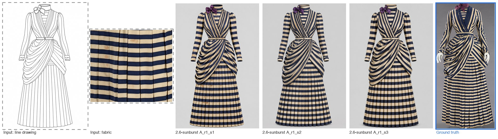
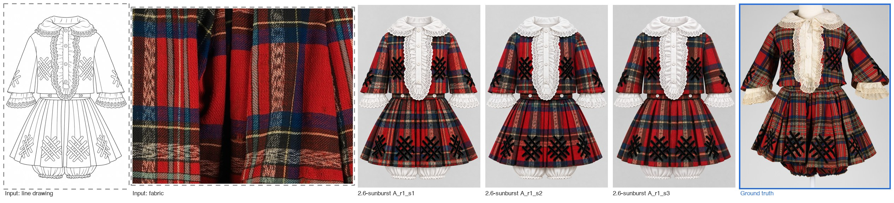

# Apparel image eval: results

Cases evaluated: C01, C02, C03, C04, C05 of 10 planned. Models: `gpt-image-2.6-sunburst`. Reviewer: Claude (claude-opus-5-5), reading each output beside its inputs and the ground truth.

## 1. Summary

- Shape is the strongest result. In all five cases every sample follows the line drawing's silhouette and construction: collars, lapels, buttons, smocking, drapes, pleats and trims land where they are drawn. Median construction score is 4-5.
- Colour is reliable when it comes from the swatch: ΔE 2.1-3.9 against the swatch for the satin, the plaid and the stripe, and matching L* for the near-black wool.
- Pattern scale is the main failure. The plaid is drawn 10-25% too large and the stripe about twice too wide, even though each swatch was cut from the garment being rebuilt.
- Material character transfers only when the swatch shows it plainly. The plaid's twill and the knit's stitch came through; the satin's sheen did not, and the satin dress came out matte.
- Colour given only in text is unreliable. The knit's gold motifs came out gold in one sample of three, and a wrong word in the description (white bloomers) went into every sample.
- Where the drawing is silent, the model chooses: stripe direction on sleeves and bodice, and pleats in a skirt that has none. A drawing that leaves something out is not a neutral input.
- The swatch is copied literally, defects included: stains on the stripe swatch reappeared on one output's skirt.
- Cost was $0.050-0.054 per image at medium quality, 1024x1536, in 16-28 seconds, plus about $0.05 per case for a traced line drawing.

## 2. Test dataset

Each case starts from a public-domain museum photo of a real garment. The model gets a line drawing and a fabric swatch made from that photo; the photo itself is the ground truth and is never sent.

| Case | Task | Garment | Fabric | Ground truth | Source |
|---|---|---|---|---|---|
| C01 | T1 | girl's dress with a smocked and pin-tucked yoke, long sleeves with lace cuffs, a draped sash at the hip, petal-cut tiers and lace flounces at the hem, with satin ribbon bows, all in the swatch fabric with cream lace | plain satin | ground_truth/photo.jpg | The Met 157319 (Dress, ca. 1885, silk/cotton, 2009.300.2489a, b) |
| C02 | T1 | woman's two-piece day dress: bodice with a crossover draped front and long sleeves, waistband, draped overskirt and pleated underskirt, all in the swatch fabric, with a small purple silk bow at the neck | stripe | ground_truth/photo.jpg | The Met 157306 (Dress, 1885-88, cotton/silk, 2009.300.2477a, b) |
| C03 | T1 | child's two-piece suit: jacket and pleated skirt in the swatch fabric with black velvet ribbon lattice trims, worn over a white cotton blouse with eyelet lace collar, jabot and cuffs, and white bloomers | check / plaid | ground_truth/photo.jpg | The Met 159177 (Suit, ca. 1860, wool/cotton/silk, 2009.300.625a-c). The same photo also shows blouse 159178 (28.220), also public domain. |
| C04 | T1 | short-sleeved knitted jacket with a stand collar, centre-front button closure, ribbed cuffs and hem, and gold patterned bands where drawn, in the swatch's knit | knit | ground_truth/photo.jpg | The Met 84229 (Sweater, late 17th century, silk, 14.134.18) |
| C05 | T1 | man's double-breasted frock coat with notched lapels, a fitted waist seam, a full skirt and covered buttons, in the swatch fabric | wool (dark, fine texture) | ground_truth/photo.jpg | The Met 84364 (Frock coat, ca. 1840, wool, C.I.38.23.39). Replaces the tweed case: no public-domain tweed garment was found. |

Licences, authors and derivations for every file are in [data/SOURCES.csv](data/SOURCES.csv).

## 3. Method

| | |
|---|---|
| API | OpenAI `POST /v1/images/edits`, all inputs in one call |
| Models | `gpt-image-2.6-sunburst` |
| Settings | medium quality, 1024x1536 |
| Prompt | One template per task type, filled only from the case's item and scale fields; no per-case tuning in round 1 (templates in [data/manifest.json](data/manifest.json)) |
| Samples | 3 per case x model x variant. The API has no seed, so samples are independent draws |
| Variant A | line drawing + fabric swatch → product photo |
| Auto-checks | CIEDE2000 between the swatch's 4 dominant colours and the garment's; pattern repeat count by autocorrelation along the case's repeat axis, compared with the ground truth's |
| Scoring | 1-5 on silhouette, fabric_pattern, pattern_scale, colour, texture, construction, usable_for_planning; pattern_scale is n/a for plain fabrics |

Input notes that affect the results:

- **C01**: Plain ivory silk satin; the only flat area is the upper sleeve, so the swatch is small. Construction is heavy (smocking, lace, petal tiers). Line drawing traced by the image model from the ground-truth photo (synthetic).
- **C02**: Stripes run on the bias in the bodice and overskirt and horizontally on the underskirt; the swatch is cut from the underskirt. Line drawing traced by the image model from the ground-truth photo (synthetic).
- **C03**: Line drawing traced by the image model from the ground-truth photo (synthetic). Swatch crop has one pleat fold down the middle that shifts the pattern; no flat area holds a full repeat. Round 1 item text wrongly says white bloomers; the bloomers in the ground truth are the plaid fabric.
- **C04**: Photographed flat. The swatch is the plain textured knit; the gold bands are described in text and drawn, not given as a swatch. Line drawing traced by the image model from the ground-truth photo (synthetic). The traced drawing straightens the real V-shaped front hem and makes the body boxier.
- **C05**: Shown on a hanger with the lining visible at the neck. Line drawing traced by the image model from the ground-truth photo (synthetic).

## 4. Results by case

Dashed grey frame = input, no frame = output, blue frame = ground truth.

### C01 · T1 · plain satin

**What worked**

- Construction matches the drawing in every sample: ruffled stand collar, pin-tucked yoke, smocked band, ribbon bows at the neck, shoulder and cuffs, the hip sash with its rosette, petal-cut tiers and hem flounces.
- Colour matches the swatch: median garment colour is ΔE 2.1-3.9 from it.

**Issues**

- The satin's sheen is lost. The dress body reads as a matte wool or brushed cotton while the ribbons stay glossy, so the model did not take the material from a small, low-contrast swatch.
- The lace is drawn as self-fabric scallops (sample 1) or white eyelet (samples 2 and 3) instead of a separate cream lace, although the description names it.
- The sash is drawn symmetrical and the skirt fuller than the original, where the sash crosses the hip on a diagonal.

| Image | silhouette | fabric pattern | pattern scale | colour | texture | construction | usable for planning |
|---|---|---|---|---|---|---|---|
| A_r1_s1.png | 5 | 3 | n/a | 4 | 2 | 5 | 3 |
| A_r1_s2.png | 5 | 3 | n/a | 4 | 2 | 5 | 3 |
| A_r1_s3.png | 5 | 3 | n/a | 4 | 2 | 5 | 3 |
| **median** | 5 | 3 | n/a | 4 | 2 | 5 | 3 |

### C02 · T1 · stripe

**What worked**

- Silhouette follows the drawing: crossover bodice, belt, asymmetric draped overskirt, knife-pleated underskirt, stand collar, puffed sleeve heads and the purple bow at the neck.
- Stripe direction follows the construction in the skirt: the stripes curve with the drape on the overskirt and run straight and horizontal on the underskirt, as on the real dress.
- Navy and cream match the swatch (ΔE 3.0-3.9) and the silk-cotton reads with the right low sheen.

**Issues**

- Stripes are about twice as wide as the real ones: 0.49-0.62 of the real dress's stripe count down the underskirt.
- Sleeves and bodice front have horizontal stripes; on the real dress they run along the sleeve and diagonally across the crossover. The drawing gives no stripe direction there, so the model chose one.
- Sample 1 copies the swatch's brown stains onto the underskirt. The model treats marks on the swatch as part of the fabric, so swatches have to be clean.

| Image | ΔE mean | ΔE max | Repeats down | vs ground truth |
|---|---|---|---|---|
| photo.jpg | 1.4 | 7.7 | 10.4 | 1.0 |
| A_r1_s1.png | 3.0 | 4.8 | 5.3 | 0.51 |
| A_r1_s2.png | 3.9 | 6.3 | 6.4 | 0.62 |
| A_r1_s3.png | 3.3 | 5.4 | 5.1 | 0.49 |

| Image | silhouette | fabric pattern | pattern scale | colour | texture | construction | usable for planning |
|---|---|---|---|---|---|---|---|
| A_r1_s1.png | 5 | 4 | 2 | 4 | 4 | 4 | 2 |
| A_r1_s2.png | 5 | 4 | 3 | 4 | 4 | 4 | 3 |
| A_r1_s3.png | 5 | 4 | 2 | 4 | 4 | 4 | 3 |
| **median** | 5 | 4 | 2 | 4 | 4 | 4 | 3 |

### C03 · T1 · check / plaid

**What worked**

- Silhouette and construction follow the drawing closely: cropped jacket with waistband and two buttons, knife-pleated skirt, three-quarter sleeves over lace cuffs, double collar and ruffled jabot.
- All nine velvet lattice trims are placed as drawn (two on the chest, two on the sleeves, five on the skirt), black and raised as described.
- The plaid carries the swatch's colour set and structure, including the pinkish slub stripes, and reads as wool twill. ΔE against the swatch is 2.6-3.3.
- Plaid is matched across the centre front of the jacket and runs continuously through the pleats.

**Issues**

- Plaid is drawn 10-25% too large (6.0-7.3 repeats across against 8.0 on the real suit). Sample 2 is the furthest off.
- Pleats are stiff, evenly pressed and shorter than the real skirt's soft, irregular, fuller pleats.
- Bloomers are white in every sample because the case description said so; the real bloomers are plaid. This is an error in the input text, not in the model.
- Blouse and lace are bright white where the original is aged cream. The prompt asked for a product photo of a new garment, so this is expected.

| Image | ΔE mean | ΔE max | Repeats across | vs ground truth |
|---|---|---|---|---|
| photo.jpg | 6.3 | 16.0 | 8.0 | 1.0 |
| A_r1_s1.png | 3.3 | 9.4 | 7.3 | 0.91 |
| A_r1_s2.png | 2.6 | 7.4 | 6.0 | 0.75 |
| A_r1_s3.png | 3.1 | 8.3 | 7.1 | 0.89 |

| Image | silhouette | fabric pattern | pattern scale | colour | texture | construction | usable for planning |
|---|---|---|---|---|---|---|---|
| A_r1_s1.png | 4 | 4 | 4 | 4 | 4 | 5 | 4 |
| A_r1_s2.png | 4 | 4 | 3 | 4 | 4 | 5 | 4 |
| A_r1_s3.png | 4 | 4 | 4 | 4 | 4 | 5 | 4 |
| **median** | 4 | 4 | 4 | 4 | 4 | 5 | 4 |

### C04 · T1 · knit

**What worked**

- Shape and layout follow the traced drawing: stand collar, centre-front knot buttons, two columns of motifs, the band across the lower body, and ribbed cuffs and hem.
- The plain areas read as knit, not woven, with a visible stitch texture in the swatch's green.
- Sample 1 renders the motifs as gold colourwork, close to the original.

**Issues**

- Samples 2 and 3 render the motifs in green relief, as if embossed or corded, although the description says gold. Only the lower band stays gold. Text that is the only source for a colour was followed in one sample of three.
- Motifs come out as raised surface decoration rather than colour knitted into the fabric.
- The green is flatter and more saturated than the mottled original. That is expected for a new garment, so it is not scored down.
- The boxy body and straight hem come from the traced drawing, not from the model; the real hem is V-shaped.

| Image | silhouette | fabric pattern | pattern scale | colour | texture | construction | usable for planning |
|---|---|---|---|---|---|---|---|
| A_r1_s1.png | 4 | 4 | 4 | 4 | 4 | 4 | 4 |
| A_r1_s2.png | 4 | 2 | 4 | 3 | 4 | 4 | 3 |
| A_r1_s3.png | 4 | 2 | 4 | 3 | 4 | 4 | 3 |
| **median** | 4 | 2 | 4 | 3 | 4 | 4 | 3 |

### C05 · T1 · wool (dark, fine texture)

**What worked**

- Construction is reproduced exactly in all three samples: notched lapels with slash buttonholes, double-breasted fastening with six covered buttons, waist seam and full skirt.
- Colour matches: swatch, real coat and outputs are all neutral near-black (median L* 11.2, 14.1 and 12.0-13.5).
- The three samples are nearly interchangeable, the lowest variance of any case.

**Issues**

- The skirt is drawn as regular pressed pleats; the real skirt flares softly from the waist seam without pleats.
- The wool's fine texture is not visible, but the swatch barely shows it either, so this case tests dark colour rather than texture.

| Image | silhouette | fabric pattern | pattern scale | colour | texture | construction | usable for planning |
|---|---|---|---|---|---|---|---|
| A_r1_s1.png | 5 | 4 | n/a | 5 | 3 | 5 | 4 |
| A_r1_s2.png | 5 | 4 | n/a | 5 | 3 | 5 | 4 |
| A_r1_s3.png | 5 | 4 | n/a | 5 | 3 | 5 | 4 |
| **median** | 5 | 4 | n/a | 5 | 3 | 5 | 4 |

## 5. Cost and latency

Cost per call is computed from the response's `usage` tokens at standard-tier prices ($5 / 1M text input, $8 / 1M image input, $30 / 1M image output).

| Step | Model | Quality, size | Calls | Mean cost | Mean latency | Total |
|---|---|---|---|---|---|---|
| drawing trace | `gpt-image-2.6-sunburst` | high, 1024x1536 | 5 | $0.0525 | 32.7s | $0.263 |
| variant A, round 1 | `gpt-image-2.6-sunburst` | medium, 1024x1536 | 15 | $0.0508 | 20.2s | $0.762 |

Total spent: **$1.025**. Per-call rows are in [results/log.csv](results/log.csv).
