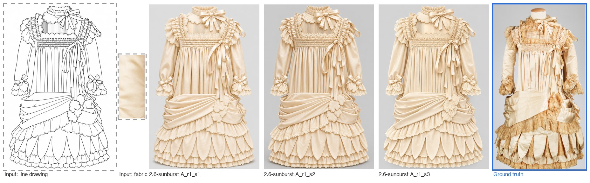
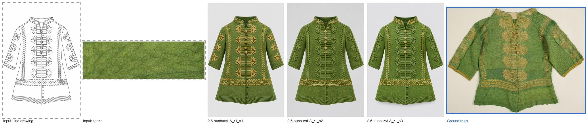
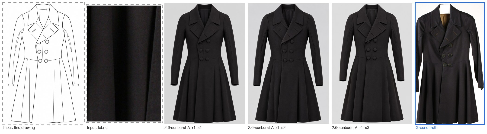
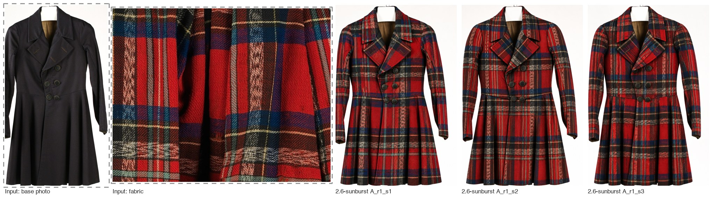
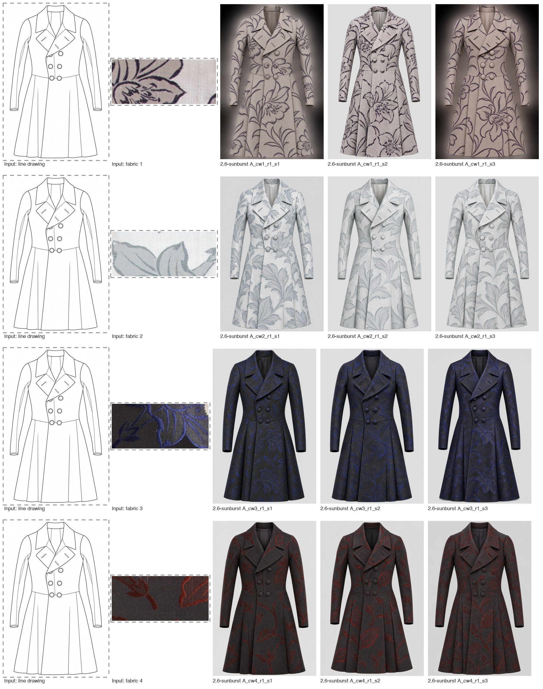
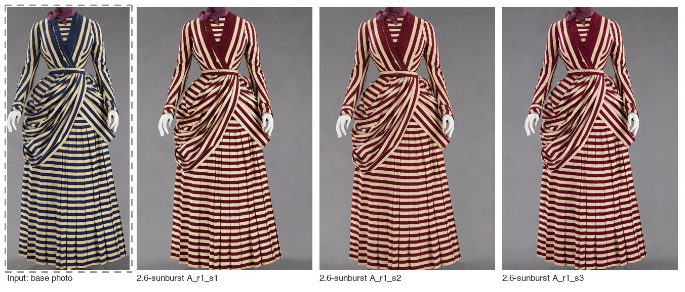
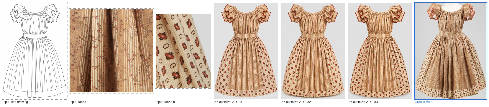
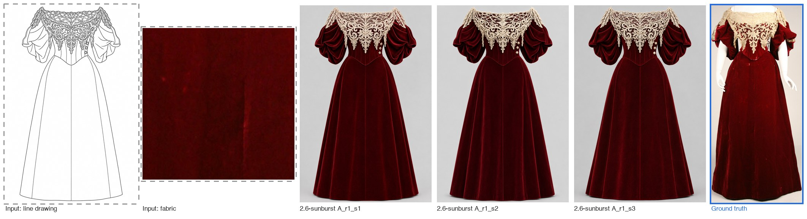

# Apparel image eval: results

Cases evaluated: C01, C02, C03, C04, C05, C06, C07, C08, C09, C10 of 10 planned. Models: `gpt-image-2.6-sunburst`. Reviewer: Claude (claude-opus-5-5), reading each output beside its inputs and the ground truth.

## 1. Summary

- Shape is the strongest result. In all ten cases the line drawing's or base photo's silhouette and construction are kept: collars, lapels, buttons, smocking, drapes, pleats, trims and puff sleeves land where they are drawn. Median construction score is 4-5.
- Editing a photo works better than building from a drawing. Re-fabricating the coat (C06) and recolouring the striped dress (C08) kept every detail of the original, with the lowest colour error of any case (ΔE 1.7-2.2) and a stripe count that did not change.
- Colour is reliable when it comes from an image: ΔE 1.7-3.9 against the swatch in most cases. Colour given only in text is not. The knit's gold motifs came out gold in one sample of three, a wrong word in the description (white bloomers) went into every sample, and a requested hex landed about ΔE 8 away.
- Pattern scale is the main failure of building from a drawing. The plaid is drawn 10-25% too large and the stripe about twice too wide, even though each swatch was cut from the garment being rebuilt.
- Material transfers unevenly. Twill, knit stitch and velvet pile came through; the satin's sheen did not, and the satin dress came out matte.
- Placement by text works. Two prints were put in the right zones (C09) although the drawing does not mark the zones.
- A colourway set is only as consistent as its swatches. Four swatches cut from different parts of one large repeat produced four different motifs on one consistent coat (C07).
- The model fills silences and copies literally: stripe direction where the drawing gives none, pleats in a skirt that has none, stains from a swatch onto a skirt, and in one colourway a dark background the prompt did not ask for.
- Cost was $0.044-0.058 per image at medium quality, 1024x1536, in 16-28 seconds, plus about $0.05 per case for a traced line drawing.

## 2. Test dataset

Each case starts from a public-domain museum photo of a real garment. The model gets a line drawing and a fabric swatch made from that photo; the photo itself is the ground truth and is never sent.

| Case | Task | Garment | Fabric | Ground truth | Source |
|---|---|---|---|---|---|
| C01 | T1 | girl's dress with a smocked and pin-tucked yoke, long sleeves with lace cuffs, a draped sash at the hip, petal-cut tiers and lace flounces at the hem, with satin ribbon bows, all in the swatch fabric with cream lace | plain satin | ground_truth/photo.jpg | The Met 157319 (Dress, ca. 1885, silk/cotton, 2009.300.2489a, b) |
| C02 | T1 | woman's two-piece day dress: bodice with a crossover draped front and long sleeves, waistband, draped overskirt and pleated underskirt, all in the swatch fabric, with a small purple silk bow at the neck | stripe | ground_truth/photo.jpg | The Met 157306 (Dress, 1885-88, cotton/silk, 2009.300.2477a, b) |
| C03 | T1 | child's two-piece suit: jacket and pleated skirt in the swatch fabric with black velvet ribbon lattice trims, worn over a white cotton blouse with eyelet lace collar, jabot and cuffs, and white bloomers | check / plaid | ground_truth/photo.jpg | The Met 159177 (Suit, ca. 1860, wool/cotton/silk, 2009.300.625a-c). The same photo also shows blouse 159178 (28.220), also public domain. |
| C04 | T1 | short-sleeved knitted jacket with a stand collar, centre-front button closure, ribbed cuffs and hem, and gold patterned bands where drawn, in the swatch's knit | knit | ground_truth/photo.jpg | The Met 84229 (Sweater, late 17th century, silk, 14.134.18) |
| C05 | T1 | man's double-breasted frock coat with notched lapels, a fitted waist seam, a full skirt and covered buttons, in the swatch fabric | wool (dark, fine texture) | ground_truth/photo.jpg | The Met 84364 (Frock coat, ca. 1840, wool, C.I.38.23.39). Replaces the tweed case: no public-domain tweed garment was found. |
| C06 | T2 | man's double-breasted frock coat | C05 coat photo + C03 plaid swatch |  | Reuses C05 (Met 84364) as the base photo and C03 (Met 159177) as the swatch; no ground truth exists for a garment re-made in another fabric |
| C07 | T3 | man's double-breasted frock coat | one design in 4 colourways from a museum textile sample book |  | Line drawing reused from C05; swatches cut from one page of a Met textile sample book (229185, 1890s) showing one floral damask in 11 colourways |
| C08 | T4 | woman's striped day dress | recolour: navy stripes to burgundy #7A1F2B, cream unchanged |  | Reuses the C02 photo (Met 157306) as the base; no ground truth |
| C09 | T5 | girl's dress with a gathered bodice, ruffled cap sleeves with red trim and a full gathered skirt | two prints placed by zone: stripe-and-sprig front panel, red floral side panels and hem border | ground_truth/photo.jpg | The Met 159521 (Dress, ca. 1850, cotton, 2009.300.935) |
| C10 | T6 | woman's evening dress with an off-the-shoulder neckline, a deep lace bertha, a pointed fitted bodice and a long gored skirt, in the swatch fabric with cream lace | construction: large draped puff sleeves; silk velvet | ground_truth/photo.jpg | The Met 85420 (Evening dress, 1893-95, silk, C.I.54.4.1a-c) |

Licences, authors and derivations for every file are in [data/SOURCES.csv](data/SOURCES.csv).

## 3. Method

| | |
|---|---|
| API | OpenAI `POST /v1/images/edits`, all inputs in one call |
| Models | `gpt-image-2.6-sunburst` |
| Settings | medium quality, 1024x1536 |
| Prompt | One template per task type, filled only from the case's item and scale fields; no per-case tuning in round 1 (templates in [data/manifest.json](data/manifest.json)) |
| Samples | 3 per case x model x variant. The API has no seed, so samples are independent draws |
| Variant A | line drawing + fabric swatch → product photo |
| Auto-checks | CIEDE2000 between the swatch's 4 dominant colours and the garment's; pattern repeat count by autocorrelation along the case's repeat axis, compared with the ground truth's |
| Scoring | 1-5 on silhouette, fabric_pattern, pattern_scale, colour, texture, construction, usable_for_planning; pattern_scale is n/a for plain fabrics |

Input notes that affect the results:

- **C01**: Plain ivory silk satin; the only flat area is the upper sleeve, so the swatch is small. Construction is heavy (smocking, lace, petal tiers). Line drawing traced by the image model from the ground-truth photo (synthetic).
- **C02**: Stripes run on the bias in the bodice and overskirt and horizontally on the underskirt; the swatch is cut from the underskirt. Line drawing traced by the image model from the ground-truth photo (synthetic).
- **C03**: Line drawing traced by the image model from the ground-truth photo (synthetic). Swatch crop has one pleat fold down the middle that shifts the pattern; no flat area holds a full repeat. Round 1 item text wrongly says white bloomers; the bloomers in the ground truth are the plaid fabric.
- **C04**: Photographed flat. The swatch is the plain textured knit; the gold bands are described in text and drawn, not given as a swatch. Line drawing traced by the image model from the ground-truth photo (synthetic). The traced drawing straightens the real V-shaped front hem and makes the body boxier.
- **C05**: Shown on a hanger with the lining visible at the neck. Line drawing traced by the image model from the ground-truth photo (synthetic).
- **C06**: base_photo.jpg is the C05 garment crop; fabric.jpg is the C03 swatch. No scale note: the plaid's real size is unknown, so pattern scale is not scored.
- **C07**: Scored on consistency across the set, since only one colourway is ever sampled in practice. Colourways: violet on white, grey-blue on white, blue on black, red on black.
- **C09**: Two swatches: fabric.jpg from the front panel, fabric_b.jpg from a side panel. Line drawing traced by the image model from the ground-truth photo (synthetic). The traced drawing shows the hem band but not the seams between the front panel and the side panels, so the side-panel placement rests on the text alone.
- **C10**: Velvet is the second material test after C01 satin: pile and sheen. Line drawing traced by the image model from the ground-truth photo (synthetic).

## 4. Results by case

Dashed grey frame = input, no frame = output, blue frame = ground truth.

### C01 · T1 · plain satin

**What worked**

- Construction matches the drawing in every sample: ruffled stand collar, pin-tucked yoke, smocked band, ribbon bows at the neck, shoulder and cuffs, the hip sash with its rosette, petal-cut tiers and hem flounces.
- Colour matches the swatch: median garment colour is ΔE 2.1-3.9 from it.

**Issues**

- The satin's sheen is lost. The dress body reads as a matte wool or brushed cotton while the ribbons stay glossy, so the model did not take the material from a small, low-contrast swatch.
- The lace is drawn as self-fabric scallops (sample 1) or white eyelet (samples 2 and 3) instead of a separate cream lace, although the description names it.
- The sash is drawn symmetrical and the skirt fuller than the original, where the sash crosses the hip on a diagonal.

| Image | silhouette | fabric pattern | pattern scale | colour | texture | construction | usable for planning |
|---|---|---|---|---|---|---|---|
| A_r1_s1.png | 5 | 3 | n/a | 4 | 2 | 5 | 3 |
| A_r1_s2.png | 5 | 3 | n/a | 4 | 2 | 5 | 3 |
| A_r1_s3.png | 5 | 3 | n/a | 4 | 2 | 5 | 3 |
| **median** | 5 | 3 | n/a | 4 | 2 | 5 | 3 |

### C02 · T1 · stripe

**What worked**

- Silhouette follows the drawing: crossover bodice, belt, asymmetric draped overskirt, knife-pleated underskirt, stand collar, puffed sleeve heads and the purple bow at the neck.
- Stripe direction follows the construction in the skirt: the stripes curve with the drape on the overskirt and run straight and horizontal on the underskirt, as on the real dress.
- Navy and cream match the swatch (ΔE 3.0-3.9) and the silk-cotton reads with the right low sheen.

**Issues**

- Stripes are about twice as wide as the real ones: 0.49-0.62 of the real dress's stripe count down the underskirt.
- Sleeves and bodice front have horizontal stripes; on the real dress they run along the sleeve and diagonally across the crossover. The drawing gives no stripe direction there, so the model chose one.
- Sample 1 copies the swatch's brown stains onto the underskirt. The model treats marks on the swatch as part of the fabric, so swatches have to be clean.

| Image | ΔE mean | ΔE max | Repeats down | vs ground truth |
|---|---|---|---|---|
| photo.jpg | 1.4 | 7.7 | 10.4 | 1.0 |
| A_r1_s1.png | 3.0 | 4.8 | 5.3 | 0.51 |
| A_r1_s2.png | 3.9 | 6.3 | 6.4 | 0.62 |
| A_r1_s3.png | 3.3 | 5.4 | 5.1 | 0.49 |

| Image | silhouette | fabric pattern | pattern scale | colour | texture | construction | usable for planning |
|---|---|---|---|---|---|---|---|
| A_r1_s1.png | 5 | 4 | 2 | 4 | 4 | 4 | 2 |
| A_r1_s2.png | 5 | 4 | 3 | 4 | 4 | 4 | 3 |
| A_r1_s3.png | 5 | 4 | 2 | 4 | 4 | 4 | 3 |
| **median** | 5 | 4 | 2 | 4 | 4 | 4 | 3 |

### C03 · T1 · check / plaid

**What worked**

- Silhouette and construction follow the drawing closely: cropped jacket with waistband and two buttons, knife-pleated skirt, three-quarter sleeves over lace cuffs, double collar and ruffled jabot.
- All nine velvet lattice trims are placed as drawn (two on the chest, two on the sleeves, five on the skirt), black and raised as described.
- The plaid carries the swatch's colour set and structure, including the pinkish slub stripes, and reads as wool twill. ΔE against the swatch is 2.6-3.3.
- Plaid is matched across the centre front of the jacket and runs continuously through the pleats.

**Issues**

- Plaid is drawn 10-25% too large (6.0-7.3 repeats across against 8.0 on the real suit). Sample 2 is the furthest off.
- Pleats are stiff, evenly pressed and shorter than the real skirt's soft, irregular, fuller pleats.
- Bloomers are white in every sample because the case description said so; the real bloomers are plaid. This is an error in the input text, not in the model.
- Blouse and lace are bright white where the original is aged cream. The prompt asked for a product photo of a new garment, so this is expected.

| Image | ΔE mean | ΔE max | Repeats across | vs ground truth |
|---|---|---|---|---|
| photo.jpg | 6.3 | 16.0 | 8.0 | 1.0 |
| A_r1_s1.png | 3.3 | 9.4 | 7.3 | 0.91 |
| A_r1_s2.png | 2.6 | 7.4 | 6.0 | 0.75 |
| A_r1_s3.png | 3.1 | 8.3 | 7.1 | 0.89 |

| Image | silhouette | fabric pattern | pattern scale | colour | texture | construction | usable for planning |
|---|---|---|---|---|---|---|---|
| A_r1_s1.png | 4 | 4 | 4 | 4 | 4 | 5 | 4 |
| A_r1_s2.png | 4 | 4 | 3 | 4 | 4 | 5 | 4 |
| A_r1_s3.png | 4 | 4 | 4 | 4 | 4 | 5 | 4 |
| **median** | 4 | 4 | 4 | 4 | 4 | 5 | 4 |

### C04 · T1 · knit

**What worked**

- Shape and layout follow the traced drawing: stand collar, centre-front knot buttons, two columns of motifs, the band across the lower body, and ribbed cuffs and hem.
- The plain areas read as knit, not woven, with a visible stitch texture in the swatch's green.
- Sample 1 renders the motifs as gold colourwork, close to the original.

**Issues**

- Samples 2 and 3 render the motifs in green relief, as if embossed or corded, although the description says gold. Only the lower band stays gold. Text that is the only source for a colour was followed in one sample of three.
- Motifs come out as raised surface decoration rather than colour knitted into the fabric.
- The green is flatter and more saturated than the mottled original. That is expected for a new garment, so it is not scored down.
- The boxy body and straight hem come from the traced drawing, not from the model; the real hem is V-shaped.

| Image | silhouette | fabric pattern | pattern scale | colour | texture | construction | usable for planning |
|---|---|---|---|---|---|---|---|
| A_r1_s1.png | 4 | 4 | 4 | 4 | 4 | 4 | 4 |
| A_r1_s2.png | 4 | 2 | 4 | 3 | 4 | 4 | 3 |
| A_r1_s3.png | 4 | 2 | 4 | 3 | 4 | 4 | 3 |
| **median** | 4 | 2 | 4 | 3 | 4 | 4 | 3 |

### C05 · T1 · wool (dark, fine texture)

**What worked**

- Construction is reproduced exactly in all three samples: notched lapels with slash buttonholes, double-breasted fastening with six covered buttons, waist seam and full skirt.
- Colour matches: swatch, real coat and outputs are all neutral near-black (median L* 11.2, 14.1 and 12.0-13.5).
- The three samples are nearly interchangeable, the lowest variance of any case.

**Issues**

- The skirt is drawn as regular pressed pleats; the real skirt flares softly from the waist seam without pleats.
- The wool's fine texture is not visible, but the swatch barely shows it either, so this case tests dark colour rather than texture.

| Image | silhouette | fabric pattern | pattern scale | colour | texture | construction | usable for planning |
|---|---|---|---|---|---|---|---|
| A_r1_s1.png | 5 | 4 | n/a | 5 | 3 | 5 | 4 |
| A_r1_s2.png | 5 | 4 | n/a | 5 | 3 | 5 | 4 |
| A_r1_s3.png | 5 | 4 | n/a | 5 | 3 | 5 | 4 |
| **median** | 5 | 4 | n/a | 5 | 3 | 5 | 4 |

### C06 · T2 · C05 coat photo + C03 plaid swatch

**What worked**

- The coat is kept exactly: hanger, brown lining at the neck, lapels with slash buttonholes, six buttons, waist seam and flared skirt all stay where they were in the base photo, with the same lighting. Shape IoU against the base is 0.86-0.88.
- The plaid is the swatch's: ΔE 1.7-2.2, the lowest of any case, with the swatch's twill and slub stripes, and it is cut on the straight grain on the body and sleeves.

**Issues**

- Plaid is not matched across the front edges or the waist seam, which a tailor would do on a coat at this price point.
- Pattern scale cannot be judged: nothing records the plaid's real size, so it is not scored.

| Image | shape iou | dE mean |
|---|---|---|
| A_r1_s1.png | 0.882 | 1.7 |
| A_r1_s2.png | 0.859 | 2.1 |
| A_r1_s3.png | 0.874 | 2.2 |

Shape IoU compares silhouettes cropped to their own bounding boxes; two unrelated full-length garments already score 0.84, so only values well above that show the shape was kept.

| Image | silhouette | fabric pattern | pattern scale | colour | texture | construction | usable for planning |
|---|---|---|---|---|---|---|---|
| A_r1_s1.png | 5 | 4 | n/a | 5 | 4 | 5 | 4 |
| A_r1_s2.png | 5 | 4 | n/a | 5 | 4 | 5 | 4 |
| A_r1_s3.png | 5 | 4 | n/a | 5 | 4 | 5 | 4 |
| **median** | 5 | 4 | n/a | 5 | 4 | 5 | 4 |

### C07 · T3 · one design in 4 colourways from a museum textile sample book

**What worked**

- The coat's shape holds across all four colourways: shape IoU against the drawing is 0.87-0.96, and lapels, waist seam and skirt pleats are the same in every image.
- Each output carries its own colourway's ground and figure colours: ΔE 2.3-3.6 for the grey-blue and red colourways, 4.9-6.2 for the violet and blue ones.
- Within one colourway the three samples agree closely with each other.

**Issues**

- The four colourways do not read as one fabric design. Each swatch is a different fragment of a large repeat, and the model draws a different motif from each: a lily outline, leaves only, mixed flowers, sparse stems. A colourway set needs every swatch cut at the same place in the repeat.
- Colourway 1 put two of its three samples on a dark vignette instead of the plain grey the prompt asks for, and those two lose buttons from the double-breasted front.
- Motif scale cannot be judged against anything, so it is not scored.

| Image | shape iou | dE mean | colourway |
|---|---|---|---|
| A_cw1_r1_s1.png | 0.87 | 6.1 | 1 |
| A_cw1_r1_s2.png | 0.927 | 3.3 | 1 |
| A_cw1_r1_s3.png | 0.87 | 6.2 | 1 |
| A_cw2_r1_s1.png | 0.925 | 3.6 | 2 |
| A_cw2_r1_s2.png | 0.941 | 3.1 | 2 |
| A_cw2_r1_s3.png | 0.929 | 3.6 | 2 |
| A_cw3_r1_s1.png | 0.925 | 6.0 | 3 |
| A_cw3_r1_s2.png | 0.927 | 5.4 | 3 |
| A_cw3_r1_s3.png | 0.919 | 4.9 | 3 |
| A_cw4_r1_s1.png | 0.947 | 2.6 | 4 |
| A_cw4_r1_s2.png | 0.93 | 3.6 | 4 |
| A_cw4_r1_s3.png | 0.958 | 2.3 | 4 |

Shape IoU compares silhouettes cropped to their own bounding boxes; two unrelated full-length garments already score 0.84, so only values well above that show the shape was kept.

| Image | silhouette | fabric pattern | pattern scale | colour | texture | construction | usable for planning |
|---|---|---|---|---|---|---|---|
| A_cw1_r1_s1.png | 4 | 4 | n/a | 3 | 4 | 3 | 2 |
| A_cw1_r1_s2.png | 5 | 4 | n/a | 4 | 4 | 4 | 3 |
| A_cw1_r1_s3.png | 4 | 4 | n/a | 3 | 4 | 3 | 2 |
| A_cw2_r1_s1.png | 5 | 3 | n/a | 4 | 4 | 5 | 4 |
| A_cw2_r1_s2.png | 5 | 3 | n/a | 4 | 4 | 5 | 4 |
| A_cw2_r1_s3.png | 5 | 3 | n/a | 4 | 4 | 5 | 4 |
| A_cw3_r1_s1.png | 5 | 4 | n/a | 3 | 4 | 5 | 4 |
| A_cw3_r1_s2.png | 5 | 4 | n/a | 3 | 4 | 5 | 4 |
| A_cw3_r1_s3.png | 5 | 4 | n/a | 3 | 4 | 5 | 4 |
| A_cw4_r1_s1.png | 5 | 4 | n/a | 4 | 4 | 5 | 4 |
| A_cw4_r1_s2.png | 5 | 4 | n/a | 4 | 4 | 5 | 4 |
| A_cw4_r1_s3.png | 5 | 4 | n/a | 4 | 4 | 5 | 4 |
| **median** | 5.0 | 4.0 | n/a | 4.0 | 4.0 | 5.0 | 4.0 |

### C08 · T4 · recolour: navy stripes to burgundy #7A1F2B, cream unchanged

**What worked**

- Only the colour changes. The dress, drape, stripe count and placement, mannequin, purple bow and background are the base photo's, and the shape IoU against it is 0.96-0.97.
- Navy becomes a burgundy close to the target (ΔE 7.4-9.4 from #7A1F2B) and the cream stays cream (ΔE 4.3-4.8 from the original).

**Issues**

- The burgundy lands about ΔE 8 from the requested hex: visibly the same family, not the same colour. A colour-critical recolour would need a correction step after generation.
- SSIM against the base is only 0.18-0.26, but that measures the model re-rendering every stripe a few pixels off, not a change in layout. It is reported and not used for scoring.

| Image | shape iou | dE dark vs target | dE light vs base | ssim |
|---|---|---|---|---|
| A_r1_s1.png | 0.964 | 9.4 | 4.6 | 0.262 |
| A_r1_s2.png | 0.96 | 7.6 | 4.8 | 0.181 |
| A_r1_s3.png | 0.97 | 7.8 | 4.3 | 0.256 |

Shape IoU compares silhouettes cropped to their own bounding boxes; two unrelated full-length garments already score 0.84, so only values well above that show the shape was kept.

| Image | silhouette | fabric pattern | pattern scale | colour | texture | construction | usable for planning |
|---|---|---|---|---|---|---|---|
| A_r1_s1.png | 5 | 5 | 5 | 4 | 5 | 5 | 5 |
| A_r1_s2.png | 5 | 5 | 5 | 4 | 5 | 5 | 5 |
| A_r1_s3.png | 5 | 5 | 5 | 4 | 5 | 5 | 5 |
| **median** | 5 | 5 | 5 | 4 | 5 | 5 | 5 |

### C09 · T5 · two prints placed by zone: stripe-and-sprig front panel, red floral side panels and hem border

**What worked**

- Both prints are placed in the right zones in every sample: the stripe-and-sprig print on the bodice, sleeves and centre front panel, the red floral print on the side panels and as the hem border. The drawing does not mark the panels, so the placement comes from the text alone.
- Ruffled cap sleeves with red picot trim, gathered bodice, waistband and gathered skirt follow the drawing.
- Print scale is close to the real dress for both fabrics.

**Issues**

- Prints are cleaner and more regular than the hand-blocked originals, which reads as a modern reproduction rather than the same cloth.
- No automatic zone check exists yet, so placement is judged by eye only.

| Image | silhouette | fabric pattern | pattern scale | colour | texture | construction | usable for planning |
|---|---|---|---|---|---|---|---|
| A_r1_s1.png | 5 | 4 | 4 | 4 | 4 | 5 | 4 |
| A_r1_s2.png | 5 | 4 | 4 | 4 | 4 | 5 | 4 |
| A_r1_s3.png | 5 | 4 | 4 | 4 | 4 | 5 | 4 |
| **median** | 5 | 4 | 4 | 4 | 4 | 5 | 4 |

### C10 · T6 · construction: large draped puff sleeves; silk velvet

**What worked**

- The velvet reads as velvet: pile, soft sheen on the folds and deep shadow in the gores. Unlike the satin in C01, the material came through.
- Construction follows the drawing: off-the-shoulder neckline, deep lace bertha, pointed bodice with side buttons, gored skirt and very large draped puff sleeves.

**Issues**

- The colour is darker than the swatch (L* 6-8 against 11.7, ΔE 4.8-6.6), a deep burgundy rather than wine.
- The sleeves are symmetrical balloons; the real ones droop toward the elbow and show a gold satin lining, which no input mentions.

| Image | silhouette | fabric pattern | pattern scale | colour | texture | construction | usable for planning |
|---|---|---|---|---|---|---|---|
| A_r1_s1.png | 5 | 4 | n/a | 3 | 5 | 4 | 4 |
| A_r1_s2.png | 5 | 4 | n/a | 3 | 5 | 4 | 4 |
| A_r1_s3.png | 5 | 4 | n/a | 3 | 5 | 4 | 4 |
| **median** | 5 | 4 | n/a | 3 | 5 | 4 | 4 |

## 5. Cost and latency

Cost per call is computed from the response's `usage` tokens at standard-tier prices ($5 / 1M text input, $8 / 1M image input, $30 / 1M image output).

| Step | Model | Quality, size | Calls | Mean cost | Mean latency | Total |
|---|---|---|---|---|---|---|
| drawing trace | `gpt-image-2.6-sunburst` | high, 1024x1536 | 7 | $0.0524 | 31.8s | $0.366 |
| variant A, round 1 | `gpt-image-2.6-sunburst` | medium, 1024x1536 | 39 | $0.0504 | 20.0s | $1.965 |

Total spent: **$2.332**. Per-call rows are in [results/log.csv](results/log.csv).
